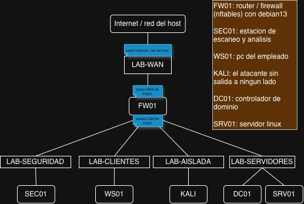

# Topología del laboratorio

**Paso 2 del plan.** Qué segmento puede hablar con cuál, y qué vive en cada uno. Las reglas de
`FW01` que implementan esta matriz están en [`lab/fw01/nftables.conf`](../lab/fw01/nftables.conf).

### 1. Matriz de tráfico

Se lee por filas: desde dónde sale la conexión (fila) y hacia dónde va (columna). Las respuestas a
una conexión permitida siempre vuelven: el firewall lleva el estado de cada conexión.

| Desde ↓ / Hacia → | WAN/Internet | Servidores | Clientes | Seguridad | Aislada |
|---|---|---|---|---|---|
| **Servidores** | DENEGAR | - | DENEGAR | DENEGAR | DENEGAR |
| **Clientes** | PERMITIR | PERMITIR | - | DENEGAR | DENEGAR |
| **Seguridad** | PERMITIR | PERMITIR | PERMITIR | - | PERMITIR |
| **Aislada** | DENEGAR | DENEGAR | DENEGAR | DENEGAR | - |

**Excepción: el DNS tiene un solo camino.** `DC01` es el DNS del lab, y es el **único** equipo
que puede consultar DNS de internet (puerto 53), siempre a través de `FW01`, que registra cada
consulta. Ningún otro equipo puede usar un DNS externo, aunque su segmento tenga salida a internet:
todos tienen que preguntarle a `DC01`. Así un equipo comprometido no puede usar su propio DNS para
esconderse o sacar datos.

### 2. Detalle de Segmentos y VMs

- **WAN / Internet** (`LAB-WAN` - Interno + NAT | `10.10.0.0/24`)
  - Gateway: `10.10.0.1`, el host
  - VMs: Ninguna (Interfaz de salida de `FW01`)
  - Propósito: Simula la conexión de la red externa o módem del proveedor.

- **Servidores** (`LAB-SERVIDORES` - Privado | `10.10.10.0/24` | GW: `10.10.10.1`)
  - VMs: `DC01`, `SRV01`
  - Propósito: Aloja infraestructura crítica de directorio activo, DNS y servicios Linux.

- **Clientes** (`LAB-CLIENTES` - Privado | `10.10.20.0/24` | GW: `10.10.20.1`)
  - VMs: `WS01`
  - Propósito: Estaciones de trabajo de empleados para probar GPOs y endpoints.

- **Seguridad** (`LAB-SEGURIDAD` - Privado | `10.10.30.0/24` | GW: `10.10.30.1`)
  - VMs: `SEC01` *(temporal)*
  - Propósito: Red dedicada de auditoría y análisis de vulnerabilidades.

- **Aislada** (`LAB-AISLADA` - Privado | `10.10.40.0/24` | GW: bloqueado)
  - VMs: `KALI` *(opcional)*
  - Propósito: Zona completamente incomunicada para pruebas de ataque.
